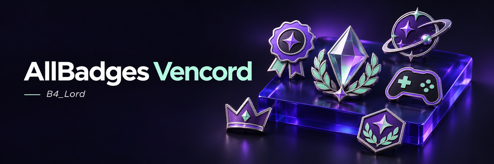

<p align="center">
  
</p>

# AllBadges Vencord

Escolha quais insígnias extras aparecem no seu próprio perfil do Discord. O plugin oferece **79 opções em oito categorias**, com prévia de cada ícone e seleção salva entre sessões. Ideal para montar a combinação que você quer ver antes de tirar um print.

[Instalação](#instalação) · [Como usar](#como-usar) · [Código-fonte](AllBadgesVencord/) · [Versões](https://github.com/Adriano-leao-dev/allbadges-vencord/releases) · [Reportar problema](https://github.com/Adriano-leao-dev/allbadges-vencord/issues)

## Catálogo

| Categoria | Opções |
| --- | ---: |
| Perfil e insígnias clássicas | 16 |
| Nitro evolutivo | 8 |
| Impulso de servidor | 9 |
| Presentes | 6 |
| Idade da conta | 10 |
| Tempo de jogo | 10 |
| Variedade de jogos | 10 |
| Transmissões | 10 |

A categoria de perfil inclui Staff, Partner, HypeSquad, Bug Hunter, Early Supporter, Active Developer, Missões, nome de usuário legado e Orbs. Consulte a referência oficial para saber como as insígnias e os níveis funcionam no Discord. [Guia de insígnias do Discord](https://support.discord.com/hc/en-us/articles/44369363856663-Discord-Profile-Badges-What-Each-Badge-Means)

## Instalação

Você precisa de uma cópia do código-fonte do **Vencord**, com Node.js e pnpm instalados. [Guia oficial de plugins personalizados](https://docs.vencord.dev/installing/custom-plugins/)

1. Baixe o ZIP da [versão publicada](https://github.com/Adriano-leao-dev/allbadges-vencord/releases/latest) ou copie a pasta [AllBadgesVencord](AllBadgesVencord/).
2. Coloque a pasta em `src/userplugins/`. O arquivo principal deve ficar em `src/userplugins/AllBadgesVencord/index.tsx`.
3. Na raiz do Vencord, rode:

   ```sh
   pnpm install --frozen-lockfile
   pnpm build
   pnpm inject
   ```

4. Reinicie o Discord e ative **AllBadgesVencord** em **Configurações → Vencord → Plugins**. Se tiver o **AllProfileBadges** antigo, deixe-o desligado. Se estiver migrando do **B4LordBadges**, retire a pasta antiga antes de compilar. O plugin aproveita a configuração salva da versão anterior.

## Como usar

1. Abra a engrenagem do **AllBadgesVencord**.
2. Expanda uma categoria e marque as variantes que quer exibir.
3. Feche e reabra o perfil para conferir o resultado.
4. Use **Mostrar as insígnias extras selecionadas** para pausar o efeito e conservar sua seleção.

A exibição é local no seu cliente. A conta, o progresso, os benefícios e a forma como outras pessoas veem seu perfil continuam sob controle do Discord. O próprio Discord pode agrupar insígnias em **+N** quando a lista fica longa.

## Como funciona

O plugin registra um provedor na BadgeAPI do Vencord e retorna as insígnias selecionadas quando o identificador do perfil corresponde à conta ativa. O catálogo aponta diretamente para os ícones do Discord. A seleção fica nas configurações do Vencord.

Se um ícone parar de carregar, abra uma issue com a categoria, o nome da variante e a versão do Vencord. Você pode conferir os links e identificadores no [catálogo](AllBadgesVencord/catalog.ts).

## Autor e créditos

<a href="https://github.com/Adriano-leao-dev"></a>

**B4_Lord** mantém o AllBadges Vencord. [Perfil no GitHub](https://github.com/Adriano-leao-dev)

- A ideia de adicionar insígnias visualmente veio do [AllProfileBadges de sidnevrekar](https://github.com/sidnevrekar/allbadges).
- Os URLs e níveis do catálogo foram adaptados do levantamento de [Riyoway](https://github.com/Riyoway/discord-badges-assets), com [licença MIT do catálogo](docs/LICENSE-catalog.txt).
- Os ícones das insígnias pertencem ao Discord ou aos respectivos titulares. A arte do banner foi criada para este projeto.

O código do plugin é distribuído sob a [GPL-3.0-or-later](LICENSE).
